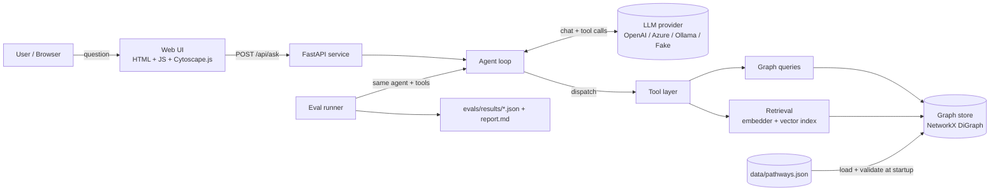
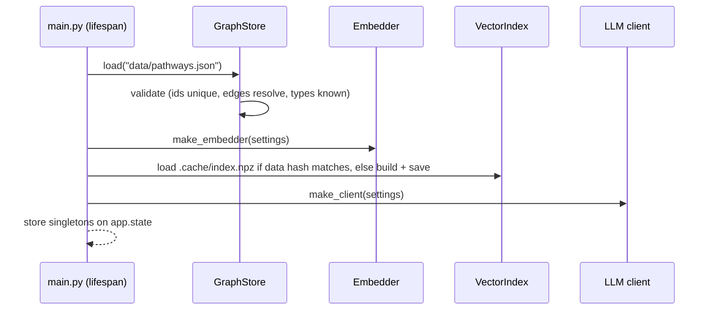
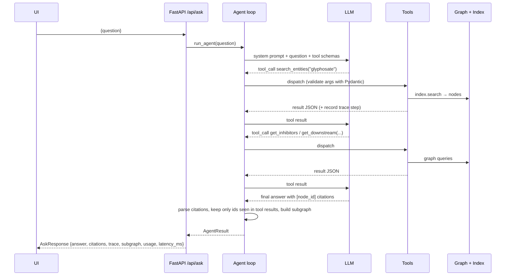
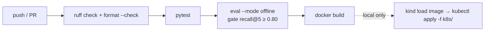

# PathwayPilot — Architecture

This document explains how PathwayPilot is put together: the tech stack, the file structure, the data model, and how a question flows through the system.

---

## 1. System overview



**Core idea:** the LLM never sees the whole graph. It only sees what the tools return, so every fact in an answer can be traced back to a tool call.

---

## 2. Tech stack

| Layer | Choice | Why |
|---|---|---|
| Language | **Python 3.11+** | Main language for AI work; you already use it |
| API | **FastAPI** + **Uvicorn** | Typed, fast, automatic OpenAPI docs at `/docs` |
| Validation | **Pydantic v2**, **pydantic-settings** | One schema for API I/O, tool arguments and config |
| Graph | **NetworkX** | No setup, runs in memory, enough for about 100 nodes. Neo4j comes later behind the same interface. |
| LLM client | **openai** Python SDK | One SDK covers Ollama (OpenAI-compatible `base_url`, **default** — free, local, no key), OpenAI and Azure OpenAI (`AzureOpenAI`) |
| Embeddings | OpenAI embeddings (configurable model); **scikit-learn TF-IDF** fallback | Real semantic search when a key is set; deterministic offline search for tests and CI |
| Vector index | **NumPy** cosine similarity, cached to `.cache/index.npz` | 100 vectors don't need a vector database |
| Frontend | Static **HTML + CSS + vanilla JS**, **Cytoscape.js** (CDN, pinned) | No build step; Cytoscape is already on your resume |
| Tests | **pytest**, FastAPI `TestClient` (httpx) | Standard |
| Lint / format | **ruff** (lint + format) | One fast tool |
| Types | **mypy** (optional, non-blocking in the MVP) | Catches bugs in tool plumbing |
| Container | **Docker** (`python:3.11-slim`) | Reproducible run |
| Orchestration | **Kubernetes** manifests, tested on **kind** | Shows K8s fundamentals without cloud cost |
| CI | **GitHub Actions** | Lint → test → offline eval gate → Docker build |
| Dependencies | **uv** (recommended) or pip with `pyproject.toml` | Fast, lockable installs |

---

## 3. File structure

```
pathwaypilot/
├── README.md                     # Demo GIF, architecture, eval table, quickstart
├── pyproject.toml                # Deps, ruff + pytest config
├── .env.example                  # All env vars, no secrets
├── Makefile                      # make dev | test | eval | eval-offline | docker | kind-up
├── Dockerfile
├── .dockerignore
├── docs/
│   ├── PRD.md
│   ├── ARCHITECTURE.md
│   ├── RULES.md
│   ├── DESIGN.md
│   ├── TASKS.md
│   └── MEMORY.md
├── data/
│   └── pathways.json             # Curated nodes + edges (public, Reactome/ChEBI refs)
├── scripts/
│   ├── validate_data.py          # Structural checks on pathways.json
│   └── build_index.py            # Pre-compute embeddings → .cache/index.npz
├── src/pathwaypilot/
│   ├── __init__.py
│   ├── config.py                 # Settings (pydantic-settings), reads env
│   ├── models.py                 # Node, Edge, ToolCallRecord, AskRequest, AskResponse, ...
│   ├── graph/
│   │   ├── store.py              # GraphStore: load JSON → DiGraph, validate, get_node
│   │   └── queries.py            # neighbors, find_path, inhibitors, downstream (pure functions)
│   ├── retrieval/
│   │   ├── embedder.py           # Embedder protocol; OpenAIEmbedder, TfidfEmbedder
│   │   └── index.py              # VectorIndex: build, save, load, search
│   ├── agent/
│   │   ├── tools.py              # Tool JSON schemas + arg models + dispatch()
│   │   ├── llm.py                # make_client(settings) → OpenAI | AzureOpenAI | FakeLLM
│   │   ├── fake_llm.py           # Scripted LLM for tests
│   │   ├── prompts.py            # System prompt
│   │   └── loop.py               # run_agent(question) → AgentResult
│   └── api/
│       ├── deps.py               # Build singletons at startup (store, index, client)
│       └── main.py               # FastAPI app, routes, static files
├── web/
│   ├── index.html
│   ├── styles.css
│   └── app.js
├── evals/
│   ├── golden.jsonl              # 20 questions with gold answers
│   ├── metrics.py                # recall@k, tool accuracy, answer match, refusal, citations
│   ├── run_eval.py               # CLI: --mode offline|full
│   └── results/                  # Timestamped outputs (git-ignored except README copy)
├── tests/
│   ├── conftest.py               # Fixtures: small graph, tfidf index, fake client
│   ├── test_store.py
│   ├── test_queries.py
│   ├── test_retrieval.py
│   ├── test_tools.py
│   ├── test_agent_loop.py
│   └── test_api.py
├── k8s/
│   ├── configmap.yaml
│   ├── secret.example.yaml       # Template only; real secret created with kubectl
│   ├── deployment.yaml
│   └── service.yaml
└── .github/workflows/ci.yml
```

**Dependency direction:** `api → agent → (tools → graph, retrieval) → models/config`. Lower layers never import from higher ones, and `graph/queries.py` has no LLM or HTTP code in it.

---

## 4. Data model

### Node types
| Type | Example | Key fields |
|---|---|---|
| `metabolite` | Phosphoenolpyruvate | `id`, `name`, `synonyms`, `description`, `chebi_id` |
| `enzyme` | EPSP synthase | `id`, `name`, `synonyms`, `description`, `ec_number` |
| `reaction` | S3P + PEP → EPSP | `id`, `name`, `description`, `pathway_step` (int), `reactome_id` |
| `pathway` | Shikimate pathway | `id`, `name`, `description`, `reactome_id` |
| `inhibitor` | Glyphosate | `id`, `name`, `synonyms`, `description`, `mechanism` |

IDs are readable, lowercase snake case with a type prefix: `met_pep`, `enz_epsps`, `rxn_shk_6`, `pw_shikimate`, `inh_glyphosate`.

### Edge types (all directed)
| Edge | From → To | Meaning |
|---|---|---|
| `SUBSTRATE_OF` | metabolite → reaction | Main input consumed |
| `PRODUCES` | reaction → metabolite | Main output |
| `COFACTOR_OF` | metabolite → reaction | ATP, NAD+, etc. **Ignored by `find_path`.** |
| `CATALYZES` | enzyme → reaction | The enzyme runs this reaction |
| `PART_OF` | reaction → pathway | The reaction belongs to this pathway |
| `INHIBITS` | inhibitor → enzyme | Blocks the enzyme's activity |

**Why reactions are nodes:** a path like glucose → pyruvate is `metabolite → reaction → metabolite → reaction …`. With reactions as nodes, one shortest-path search returns the metabolites, the reactions and (one hop away) the enzymes. It also lets a reaction have several substrates, like S3P + PEP.

### `pathways.json` shape
```json
{
  "version": "1.0",
  "source_note": "Curated from Reactome (CC BY 4.0) and ChEBI for demonstration.",
  "nodes": [
    {"id": "enz_epsps", "type": "enzyme", "name": "EPSP synthase",
     "synonyms": ["5-enolpyruvylshikimate-3-phosphate synthase", "AroA"],
     "description": "Transfers the enolpyruvyl group of PEP to shikimate-3-phosphate, forming EPSP.",
     "ec_number": "2.5.1.19"}
  ],
  "edges": [
    {"source": "enz_epsps", "target": "rxn_shk_6", "type": "CATALYZES"}
  ]
}
```

---

## 5. App flows

### 5.1 Startup

If validation fails, the app **does not start**. A broken graph must never serve answers.

### 5.2 Ask a question (main flow)


**Agent loop rules**
- `temperature = 0`; at most **6** tool steps (`MAX_STEPS`)
- Tool arguments are validated by Pydantic. A bad argument or unknown node ID becomes an **error message sent back to the model**, not an exception.
- Several tool calls in one turn are run in order and all recorded.
- If the step cap is hit, the loop asks the model for its best answer so far and marks `truncated: true`.
- Citations are extracted with the regex `\[([a-z]+_[a-z0-9_]+)\]`. Any ID not seen in a tool result is dropped and logged as `invalid_citation`.

### 5.3 Evaluation flow
```mermaid
flowchart TD
    G[evals/golden.jsonl] --> R{mode}
    R -->|offline| O[search_entities only<br/>TF-IDF embedder<br/>no LLM]
    R -->|full| F[run_agent per question<br/>real LLM]
    O --> M1[recall@5, MRR]
    F --> M2[recall@5, tool accuracy, answer accuracy,<br/>refusal accuracy, citation validity,<br/>latency p50/p95, tokens]
    M1 --> OUT[results/timestamp.json + report.md]
    M2 --> OUT
    OUT --> CI{CI: recall@5 >= 0.80?}
    CI -->|no| FAIL[fail build]
```

### 5.4 CI / deploy flow


---

## 6. How the components interact

| Component | Owns | Called by | Calls | Contract |
|---|---|---|---|---|
| `config.Settings` | Env vars and defaults | Everything at startup | — | Immutable after startup |
| `graph.store.GraphStore` | The DiGraph, node lookup, validation | queries, index build, API `/node` | NetworkX | `get_node(id) → Node`; raises `NodeNotFound` |
| `graph.queries` | Traversal logic | `agent.tools` | `GraphStore` | Pure functions returning Pydantic models; no I/O |
| `retrieval.embedder` | Text → vectors | `VectorIndex` | OpenAI API or sklearn | `embed(list[str]) → np.ndarray` |
| `retrieval.index.VectorIndex` | Node vectors, cosine search | `agent.tools`, `/api/search`, evals | Embedder | `search(query, k, types) → list[SearchHit]` |
| `agent.tools` | Tool schemas, arg validation, dispatch | `agent.loop` | queries, index | `dispatch(name, args_json) → (result_json, ToolCallRecord)` |
| `agent.llm` | Provider client creation | `agent.loop` | OpenAI SDK | Returns an object with `.chat.completions.create(...)` |
| `agent.loop` | Conversation, step cap, citations, subgraph | API, evals | llm, tools | `run_agent(question) → AgentResult` |
| `api.main` | HTTP, static UI, startup wiring | Browser, curl, tests | agent, index, store | Pydantic request/response models |
| `web/app.js` | Rendering answer, trace, graph | Browser | `/api/*` | Only reads `AskResponse`; no business logic |
| `evals.run_eval` | Scoring, reports | Developer, CI | agent, index | Writes JSON + Markdown; exit code 1 if the gate fails |

---

## 7. API contract

### `POST /api/ask`
Request:
```json
{ "question": "What does glyphosate inhibit, and what is blocked downstream?" }
```
Response (`200`):
```json
{
  "answer": "Glyphosate inhibits EPSP synthase [enz_epsps], which ...",
  "citations": [{"id": "enz_epsps", "name": "EPSP synthase", "type": "enzyme"}],
  "trace": [
    {"step": 1, "tool": "search_entities", "args": {"query": "glyphosate", "k": 5},
     "result_summary": "5 hits; top: inh_glyphosate (0.91)", "duration_ms": 42, "error": null}
  ],
  "subgraph": {"nodes": [{"id": "...", "name": "...", "type": "..."}],
               "edges": [{"source": "...", "target": "...", "type": "..."}]},
  "usage": {"prompt_tokens": 1830, "completion_tokens": 212},
  "latency_ms": 3120,
  "truncated": false
}
```
Errors: `422` for an empty or over-long question (over 500 chars); `503` if the LLM provider is unreachable (the message says which provider and why).

### Other routes
| Route | Returns |
|---|---|
| `GET /api/search?q=...&k=5&types=enzyme,inhibitor` | `list[SearchHit]` |
| `GET /api/node/{id}` | Node plus its immediate neighbors |
| `GET /api/health` | `{"status": "ok", "nodes": 74, "edges": 160, "provider": "openai", "embedder": "openai"}` |
| `GET /` | The web UI |
| `GET /docs` | OpenAPI docs (FastAPI built-in) |

---

## 8. Configuration (env vars)

| Variable | Default | Notes |
|---|---|---|
| `LLM_PROVIDER` | `ollama` | `ollama` \| `openai` \| `azure` \| `fake` — `ollama` is the default: free, local, no key needed. Tests and CI use `fake` explicitly regardless of this default. |
| `LLM_MODEL` | — | Any chat model with tool calling. For `ollama`, a locally pulled model tag (e.g. a small open-weight model that supports tool calling); for Azure, the deployment name. |
| `OPENAI_API_KEY` | — | For `openai` and OpenAI embeddings; not needed for the `ollama` default |
| `AZURE_OPENAI_ENDPOINT`, `AZURE_OPENAI_API_KEY`, `AZURE_OPENAI_API_VERSION` | — | For `azure` |
| `OLLAMA_BASE_URL` | `http://localhost:11434/v1` | For `ollama` (the default). In Docker or `kind`, `localhost` is the container, not the host — use `http://host.docker.internal:11434/v1` (Docker Desktop) or the host's LAN IP instead. |
| `EMBEDDER` | `tfidf` | `openai` \| `tfidf` |
| `EMBEDDING_MODEL` | — | e.g. a small OpenAI embedding model |
| `MAX_STEPS` | `6` | Agent tool-step cap |
| `LLM_TIMEOUT_S` | `30` | Per LLM call |
| `DATA_PATH` | `data/pathways.json` | |
| `LOG_LEVEL` | `INFO` | |

---

## 9. Deployment (Kubernetes on kind)

| Manifest | Contents |
|---|---|
| `configmap.yaml` | `LLM_PROVIDER`, `LLM_MODEL`, `EMBEDDER`, `MAX_STEPS`, `LOG_LEVEL` |
| `secret.example.yaml` | Key names only. Create the real one with `kubectl create secret generic pathwaypilot-secrets --from-literal=OPENAI_API_KEY=...` |
| `deployment.yaml` | 2 replicas; `envFrom` the ConfigMap and Secret; readiness and liveness probes on `/api/health`; requests `100m`/`256Mi`, limits `500m`/`512Mi`; `imagePullPolicy: IfNotPresent` |
| `service.yaml` | `ClusterIP` on port 80 → 8000; access with `kubectl port-forward svc/pathwaypilot 8000:80` |

Commands:
```bash
docker build -t pathwaypilot:0.1.0 .
kind create cluster --name pp
kind load docker-image pathwaypilot:0.1.0 --name pp
kubectl apply -f k8s/
kubectl port-forward svc/pathwaypilot 8000:80
```

---

## 10. Error handling and observability
- **Structured logs:** one JSON log line per request with `request_id`, `question_len`, `steps`, `tools`, `latency_ms`, `tokens`, `truncated`, `invalid_citations`
- **Tool errors** go back to the model as `{"error": "Node 'enz_xyz' not found. Use search_entities first."}` so it can recover
- **LLM errors:** one retry with backoff for 429 and 5xx; after that, return `503`
- **Trace:** every response carries the full trace, so wrong answers can be debugged from the UI alone

## 11. Extension points
- `GraphStore` is the seam for Neo4j: implement the same methods with Cypher
- `Embedder` is the seam for new embedding models
- New tools are one function in `queries.py`, one schema and arg model in `tools.py`, and one test
